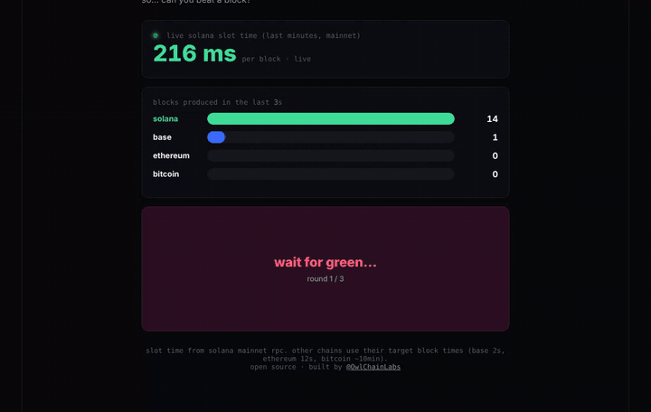

# ⚡ faster than solana?

solana blocks now land every ~200ms. the average human reaction is around 250ms.
can you beat a block?

**try it: [speed.owlchainlabs.xyz](https://speed.owlchainlabs.xyz)**



## what it does

1. shows the live solana slot time from mainnet rpc (`getRecentPerformanceSamples`, fetched server side in `functions/api/slot.js`)
2. races solana against base, ethereum and bitcoin block by block
3. a 3 round reaction test: wait for green, tap
4. tells you how many times slower you are than a solana block
5. tag a friend and post your result on x, or save a share card

## how the numbers work

- solana: average slot time of the last ~10 performance samples. if the rpc is not reachable it falls back to the 200ms target
- base 2s, ethereum 12s, bitcoin ~10min: their target block times
- your score is the average of 3 rounds. tapping before green resets the round

## run it yourself

the page is one html file in `public/`. a tiny cloudflare worker (`worker.js`) serves it and adds `/api/slot`, which reads the slot time server side so your rpc key never reaches the browser.

```bash
git clone https://github.com/OwlChainLabs/speed-test
cd speed-test
npx wrangler secret put HELIUS_RPC_URL   # your helius rpc url or just the api key
npx wrangler deploy
```

without a key it falls back to the public rpc, and if that is blocked the page shows the 200ms target instead of live data.

## license

MIT · built by [@OwlChainLabs](https://x.com/OwlChainLabs)
